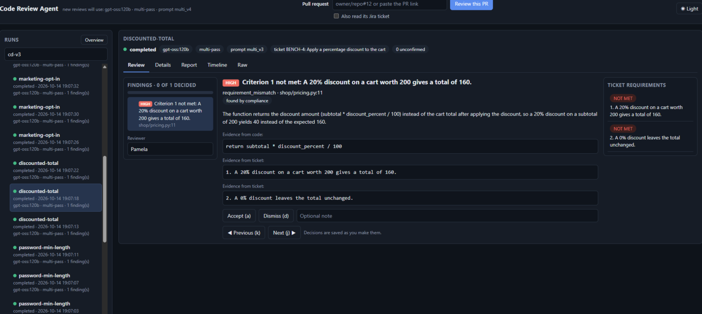

# Agent de revue de code : Pull Request vs exigences du ticket

Un agent d'assistance à la revue de code **libre de droits** : il lit une Pull Request GitHub et le ticket Jira qui lui est lié, interroge un modèle de langage
**à poids ouverts** (Ollama : gpt-oss, Qwen) et produit des constats structurés, chacun avec sa **preuve citée** (fichier, ligne, extrait vérifié), contre les critères d'acceptation du ticket.

> **Le réviseur humain garde la décision finale.** L'outil ne fusionne rien, ne publie rien sans demande explicite et ne modifie jamais un dépôt : l'accès à GitHub et à Jira est en lecture seule.

[Fonctionnalités](#fonctionnalités) · [Démarrage rapide](#démarrage-rapide) · [Utilisation](#utilisation-en-ligne-de-commande) · [Configuration](#configuration) · [Architecture](#architecture) · [Tests](#tests) · [Contribuer](#contribuer) · [Documentation](#documentation) · [Licence](#licence)



*Écran de revue d'une PR de démonstration : à gauche les constats (les plus graves d'abord), au centre le constat choisi avec ses preuves (code et ticket) et les boutons Accept / Dismiss, à droite les exigences du ticket (MET / NOT MET). Thème sombre par défaut, bouton Light / Dark en haut à droite.*

## Fonctionnalités

- **Revue contre le ticket** : un verdict par critère d'acceptation (*met*, *not met*, *cannot determine*), avec preuves citées.
- **Pipeline multi-passes** : spécialistes (conformité au ticket, défauts, sécurité, règles d'équipe), fusion des doublons, puis passe de vérification qui peut écarter un constat (toujours visible, avec la raison).
- **Preuves sans modèle** : analyse statique (Ruff, Bandit), profil du changement, graphe de code léger (appelants, tests, fonctions appelées).
- **Validation** : chaque fichier, ligne et citation cités doivent exister dans ce que le modèle a reçu, sinon le constat est signalé. (Un constat ancré n'est pas forcément vrai : c'est le rôle du réviseur.)
- **Interface web locale** : écran de revue en trois panneaux, tri au clavier (`j`/`k`, `a`, `d`), enregistrement automatique, vue d'ensemble, comparaison de configurations.
- **Évaluation reproductible** : banc d'essai, comparaison côte à côte, import des réponses d'un agent plus avancé utilisé dans un chat.
- **Intégration GitHub** : commentaire unique et auto-mis à jour sur la PR, modèle de workflow GitHub Actions.

## Démarrage rapide

Prérequis : [uv](https://docs.astral.sh/uv/) (gère Python 3.12 automatiquement) et Git.

```bash
git clone https://github.com/ebirdyx/code-review-agent.git
cd code-review-agent
uv sync
uv run pytest -q                 # 600+ tests, aucun ne nécessite de modèle ni de réseau
uv run review-agent check-examples
```

Définir la clé du modèle (Ollama Cloud, palier gratuit : https://ollama.com/settings/keys), puis ouvrir un **nouveau** terminal. Sous Windows (PowerShell) :

```powershell
[Environment]::SetEnvironmentVariable("OLLAMA_API_KEY", "votre-cle", "User")
```

Vérifier la configuration, puis lancer l'interface :

```bash
uv run review-agent doctor        # modèle, Jira, GitHub, outils : tout doit afficher OK
uv run review-agent ui --open     # http://127.0.0.1:8765/
```

Dans l'interface, saisir une PR (par exemple `ebirdyx/shipping-demo#1`), cocher « Also read its Jira ticket » au besoin et lancer la revue.

## Utilisation en ligne de commande

```bash
uv run review-agent review examples/free-shipping-faulty              # un exemple local
uv run review-agent review-pr proprietaire/depot#12 --jira            # PR GitHub + ticket Jira lié
uv run review-agent eval-run --split dev --repeat 3 --label multi-full  # évaluation (appelle le modèle)
uv run review-agent eval-compare runs/eval-single-pass-* runs/eval-multi-full-*
```

Chaque revue crée un dossier dans `runs/` : réglages, texte exact envoyé, réponse brute, résultat validé et rapport. Toutes les commandes : [docs/usage.md](docs/usage.md).

## Configuration

| Variable | Rôle |
|---|---|
| `OLLAMA_API_KEY` | Clé Ollama Cloud. **Ne jamais la mettre dans le dépôt.** |
| `GITHUB_TOKEN` | Optionnel. Sans jeton : 60 requêtes/heure, dépôts publics seulement. |
| `JIRA_BASE_URL`, `JIRA_EMAIL`, `JIRA_API_TOKEN` | Optionnelles, pour lire le ticket Jira lié à la PR. |
| `REVIEW_AGENT_PROFILE` | Profil de modèle (`uv run review-agent profiles` les liste). |

Profils, modèles locaux (Qwen avec Ollama), Qwen hébergé, prix et confidentialité : [docs/configuration.md](docs/configuration.md).
**Confidentialité** : avec un profil hébergé, le diff et le ticket sont envoyés à un tiers. N'y envoyez pas de code confidentiel ; seul un modèle local garde le code sur la machine.

## Tests

```bash
uv run pytest -q                       # 600+ tests ; modèle et GitHub simulés, Ruff et Bandit réels
uv run ruff check src tests            # style
uv run review-agent check-examples     # vérifie les exemples et les réponses attendues
```

Les tests sont rangés comme le code (`tests/pipeline`, `tests/connectors`, `tests/context`, `tests/llm`, `tests/reporting`, `tests/evaluation`, `tests/app`). Aucun ne nécessite de clé, de modèle ni de réseau.

## Architecture

```
ticket Jira / PR GitHub / dossier local
        |
  connectors/    lire les entrées (lecture seule) -> instantané enregistré sur disque
  context/       préparer ce que le modèle verra : contexte, graphe de code, analyse statique
  pipeline/      passes spécialisées -> fusion -> vérificateur -> validation   <--  llm/ (clients et profils)
  reporting/     rapport Markdown, commentaire de PR
  app/           ligne de commande, service partagé, interface web locale
  evaluation/    mesurer l'agent : notation et comparaison de configurations
```

Le code est dans `src/code_review_agent/`, en couches, avec des dépendances à sens unique. Détail fichier par fichier, pipeline et validation : [docs/architecture.md](docs/architecture.md).

## État et limites

Le pipeline, la validation, les connecteurs, l'interface et l'outillage d'évaluation sont faits et testés ; le connecteur Jira et une revue de bout en bout ont été exécutés pour de vrai.
Ce qui reste **à faire ou à prouver** : les étiquettes du banc d'essai doivent être confirmées par une personne, la qualité n'est mesurée que sur peu de cas, Qwen n'a pas été exécuté en local,
le workflow GitHub Actions n'est pas encore actif sur un vrai dépôt, et la comparaison avec un agent plus avancé reste à compléter. **Aucun chiffre de qualité n'est définitif.**
Tableau complet, méthode d'évaluation, résultats préliminaires et limites connues : [docs/project-status.md](docs/project-status.md).

## Contribuer

1. Créer une branche, faire la modification, puis `uv run pytest -q` : tout doit passer (un test accompagne chaque changement de comportement).
2. Ne jamais mettre de clé, de jeton ni de donnée privée dans le dépôt (variables d'environnement ou secrets CI seulement).
3. Ajouter un cas au banc d'essai : voir [docs/hand-over.md](docs/hand-over.md) (dossier `evaluation/cases/<id>/`, réponse attendue, `split.json`).
4. Les équipes suivantes trouveront les pistes et les pièges dans [docs/hand-over.md](docs/hand-over.md).

## Documentation

| Document | Contenu |
|---|---|
| [docs/usage.md](docs/usage.md) | Commandes, interface web, mise en place de Jira, GitHub Actions |
| [docs/configuration.md](docs/configuration.md) | Variables, profils de modèles, modèle local, confidentialité |
| [docs/architecture.md](docs/architecture.md) | Couches, pipeline multi-passes, preuves sans modèle, ce que la validation prouve |
| [docs/project-status.md](docs/project-status.md) | État, méthode d'évaluation, résultats préliminaires, limites |
| [docs/hand-over.md](docs/hand-over.md) | **Pour les prochaines équipes** : démarrage en 10 minutes, à faire dans l'ordre, pièges |
| [docs/evaluation-howto.md](docs/evaluation-howto.md) | Évaluer et comparer des configurations de façon reproductible |
| [docs/comparison-protocol.md](docs/comparison-protocol.md) | Comparer avec Claude / ChatGPT / Gemini dans un chat, sans clé d'API |
| [docs/findings-log.md](docs/findings-log.md) | Ce que nous avons appris en construisant l'agent |
| [docs/model-comparison-notes.md](docs/model-comparison-notes.md) | Observations réelles par modèle |

## Licence

Ce logiciel est publié sous licence **MIT** (voir [`LICENSE`](LICENSE)). Les modèles utilisés sont à poids ouverts sous licence Apache-2.0 (`gpt-oss`, Qwen2.5-Coder).
Ollama Cloud est un **service** : usage limité (palier gratuit), et le code envoyé quitte la machine. Détail des licences et des versions : [docs/configuration.md](docs/configuration.md).
